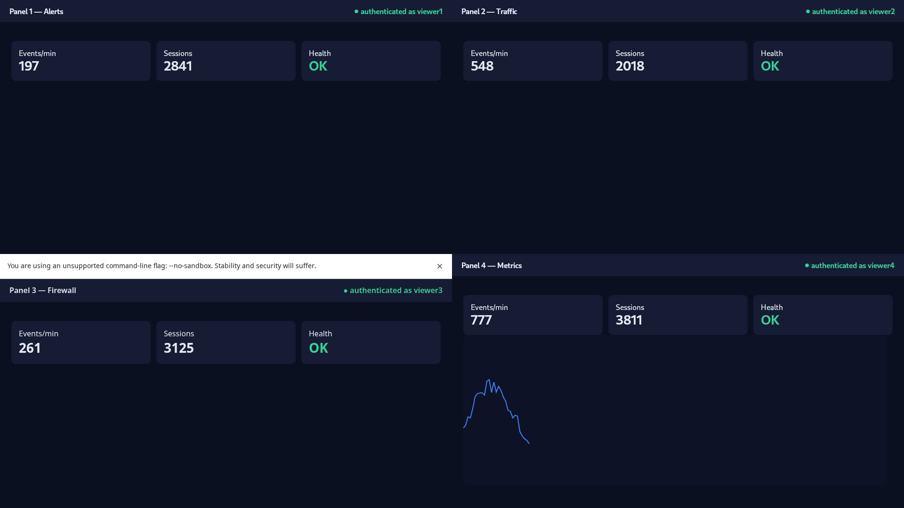

# p2soc — Raspberry Pi 5 → SOC Video Wall

[](LICENSE)


Convert a Raspberry Pi 5 (1 GB) into a **Security-Operations-Center video wall**:
an HDMI display that boots straight into a **taskbar-less desktop with four
draggable browser windows in a 2×2 grid**. Each window shows a different web
panel (different IP/port), **auto-logs in** from a local secrets vault, and
**keeps the session alive / re-logs-in** on timeout. One or more panels can live
on a remote network reached only through an **SSH jump host**, kept up by a
persistent **autossh** tunnel, or behind a supervised **VPN** — **Fortinet
SSL-VPN, OpenVPN, WireGuard, or iNode** (`vpn.type`) — with auto-reconnect, health
checks, and classified error handling, credentials from the same vault. Tiles
are **universal**: point any panel at any URL from the **on-screen config**
(corner ⚙ or Ctrl+Shift+C, optional PIN lock) — no SSH, no file editing. Outbound
traffic can go through an **authenticated HTTP(S)/SOCKS proxy** whose credentials
also come from the vault and are answered **in memory** (never on argv or disk).
Everything starts on boot and self-heals: crashed web processes reload, dead
panels show a clear on-screen status card and retry with backoff, Chromium
respawns, the VPN reconnects.

Runs on **X11 (X.Org or XLibre, Openbox)** or **Wayland (cage / labwc)**, on
**x86-64 and ARM**, and installs on **Raspberry Pi OS / Debian / Ubuntu,
Fedora/RHEL, Arch, openSUSE, Alpine and Void** — plus any other distro with
`SOC_SKIP_PACKAGES=1`, and degrades gracefully on non-systemd inits. The Pi 5 is
the reference target. Built entirely from open-source parts: **WebKitGTK** (with
a **Chromium** fallback per panel), **Vaultwarden** with a native client that
also provides the `litebw` command, **autossh**,
**openfortivpn**, **systemd**, **zram**. It auto-profiles the hardware (lighter
WebKit cache on 1 GB boards, GPU compositing on the Pi 5).



> The development wall with four panels logged in — WebKit
> direct, WebKit through a tunnel, Chromium via CDP, and a WebKit panel with a
> live chart.

## Docs

- [**Full setup guide**](docs/SETUP.md) — display, Vaultwarden and network configuration
- [**Production deploy**](docs/DEPLOY.md) — kiosk services and unattended configuration
- [**Zero-touch operation**](docs/AUTO_UPDATE.md) — how a wall runs, recovers and redeploys itself with nobody there
- [Architecture](docs/ARCHITECTURE.md) — topology, boot/data-flow, RAM budget, rationale
- [Install on the Pi](docs/INSTALL.md) — step-by-step bring-up + checklist
- [Configuration](docs/CONFIGURATION.md) — `panels.yaml` reference, finding selectors, keep-alive
- [Security](docs/SECURITY.md) — threat model, the unattended-unlock tradeoff, hardening
- [Development](docs/DEVELOPMENT.md) — dev harness, make targets, testing
- [Performance](docs/PERFORMANCE.md) — measured Rust and Python resource use
- [Releasing](docs/RELEASING.md) — package targets and versioning
- [Changelog](CHANGELOG.md) — what changed

---

## How it works

```
systemd (system)
  ├─ zram (zstd)                compressed swap so 1 GB holds 4 panels
  ├─ vaultwarden.service        encrypted vault on 127.0.0.1:8222
  ├─ autossh-tunnel.service     autossh -L 127.0.0.1:191xx:remote:port  user@jump
  └─ forti-vpn.service          supervised openfortivpn → FortiGate SSL-VPN
                                (vault creds, auto-reconnect + health check,
                                 systemd watchdog, STATUS= in systemctl status)

getty@tty1 autologin (soc) → start-session.sh   (SOC_SESSION=x11|wayland|auto)
  ├─ x11:     startx → Openbox → launcher.sh → soc-wall supervise
  │           Openbox rc.xml forces each WM_CLASS=soc-pN window into its cell
  └─ wayland: cage (all-webkit wall → ONE fullscreen grid window)
              or labwc (generated window rules tile the panel windows)
  kiosk host:
        ├─ litebw unlock + sync → read the logins into RAM
        ├─ engine: webkit  → WebKitWebView; native login injection; crash auto-reload
        └─ engine: chromium→ chromium --app + CDP login injection; auto-respawn
```

**Auto-login is injected by the host**, not by a browser extension or a network
service: the host reads credentials from the vault and types them into each
view itself (WebKit via a `socCreds` message handler; Chromium via the DevTools
Protocol on localhost). There is **no credential broker, no open port, no
page-context fetch** — credentials never leave the host process except as the
values typed into the login form.

WebKitGTK is the default for each panel. Chromium is available for dashboards
that require it. The [resource comparison](docs/PERFORMANCE.md) measures the wall
and its browser processes on four local WebKit dashboards.

---

## Repo layout

| Path | What |
|------|------|
| `config/panels.yaml` | wall config (panels, tunnel, vpn, proxy). In production the Vaultwarden `SOC Wall Config` note is the source of truth; this file is the offline fallback |
| `rust/` | Native wall, dashboard engines, settings, vault, VPN, setup, and updater |
| `kiosk-host/host/` | Python compatibility runtime and reference implementation |
| `inject/login.js.tmpl` | shared auto-login + keep-alive + re-login script (both engines) |
| `openbox/` | `rc.xml.tmpl` (2×2, no panel, draggable), `menu.xml`, `autostart` |
| `labwc/` | `rc.xml.tmpl` — the Wayland twin of the Openbox config |
| `scripts/` | session, desktop, systemd, and pinentry entry points |
| `systemd/` | `vaultwarden(-docker).service`, `autossh-tunnel.service`, `forti-vpn.service`, `getty-autologin.conf` |
| `security/` | `nftables.conf`, `sshd_hardening.conf`, `zram.conf`, `99-soc-sysctl.conf`, `tunnel_key.note` |
| `dev/benchmark.py` | reproducible dashboard benchmark for the Rust and Python hosts |
| `setup.py` | setup entry point for the Python compatibility runtime |
| `install.sh` | idempotent multi-distro installer (apt/dnf/pacman/zypper/apk/xbps, X.Org/XLibre/Wayland) |

---

## Try it on your workstation (no Pi needed)

Source builds need Rust 1.87 or newer, a C compiler, `pkg-config`,
GTK 3 and WebKitGTK 4.1 development headers. Install Xvfb for the GUI tests and
Chromium if you use Chromium panels. The desktop preview opens an empty wall
with a development vault. Set a panel URL in Settings or pass `SOC_PANELS_FILE`.

```bash
./launch.sh              # build and open the wall in a desktop window
./launch.sh --headless   # run WebKit and Settings smoke tests under Xvfb
./launch.sh --setup      # terminal setup menu
make test                # Rust workspace tests, including GUI tests
make test-python         # Python compatibility suite
```

The installed binary also provides the standalone tools:

```bash
soc-wall setup-gui
soc-wall setup doctor
soc-wall setup-gui --list-presets
soc-wall update status
```

---

## Install on the Raspberry Pi (or any supported distro)

Flash **Raspberry Pi OS (64-bit)** — or start from Debian/Ubuntu, Fedora/RHEL,
Arch, openSUSE, Alpine or Void — enable SSH, boot, copy this repo over, then
configure with the interactive wizard and run the installer:

```bash
make rust-release
sudo ./rust/target/release/soc-wall setup deploy --mode kiosk
```

Installation wires the kiosk for the next boot. It starts at boot, recovers from failures and redeploys
itself from the tracked branch, rolling back automatically if a release won't run
([details](docs/AUTO_UPDATE.md)). For imaging or a fleet, `deploy --unattended` does it
with no prompts at all ([docs/DEPLOY.md](docs/DEPLOY.md)).

`INSTALL_MODE=auto` takes over tty1 (**kiosk**) on a box with no desktop environment,
and leaves the boot alone (**desktop**) where a display manager is in use, so a
workstation is never hijacked. Desktop mode adds a clickable **"SOC Wall"** launcher to
the apps menu that runs against the current `$DISPLAY`/`$WAYLAND_DISPLAY`.

Auto-installs packages via apt/dnf/pacman/zypper/apk/xbps; honours an existing
X.Org **or XLibre** server; degrades gracefully without systemd (prints the
service + autologin steps to wire up by hand). See [docs/INSTALL.md](docs/INSTALL.md).

The wizard (`soc-wall setup wizard`) is re-runnable and writes and validates all three config
files; see the [full setup guide](docs/SETUP.md). You can also edit the
`*.example` templates by hand.

The installer: installs deps, creates the `soc` (kiosk), `socsvc` (tunnel) and
`socupdate` (redeploy) users, deploys a release under `/opt/soc-releases` with
`/opt/soc-display` pointing at it, installs the native binary and writes `/etc/soc-display`
config, sets up Vaultwarden, autossh and `soc-update` units, zram, the Openbox session,
and the "SOC Wall" menu launcher. In **kiosk** mode it additionally enables tty1
autologin and **disables the desktop session** (keeps your preloaded card; the
desktop just doesn't run) — same RAM benefit as Pi OS Lite — and switches on the
hardware watchdog. Either way it is
**reversible**: the install records a manifest and `./uninstall.sh` (or `make
uninstall`) replays it, preserving operator vault data by default and restoring
the console; `--purge` removes everything (see [docs/INSTALL.md](docs/INSTALL.md#uninstall)).

### Finding selectors for a panel
Open the panel's login page in a browser, right-click the username field →
Inspect, and copy a CSS selector for the username input, password input, and the
submit button into `selectors:`. `login_marker` should be a selector that exists
**only** on the login page (usually the password field) — it's how the host
detects a logged-out state and re-logs-in.

---

## Configuration reference (`panels.yaml`)

```yaml
panels:
  - id: p1                      # short id; window class becomes soc-p1
    engine: webkit              # webkit (light, default) | chromium (fallback)
    grid: [0, 0]                # [col, row] in the 2x2 grid
    mode: direct                # direct | tunnel
    url: "http://10.0.0.5:3000/login"
    # for mode: tunnel, instead of url:
    # tunnel: {local_port: 19103, remote_host: 10.20.0.7, remote_port: 8443}
    # path: "/login"  ; scheme: http
    vault_item: "SOC Panel 1"   # Vaultwarden login item name
    selectors: {user: "#username", pass: "#password", submit: "button[type=submit]"}
    login_marker: "#password"   # exists only on the login page
    keepalive: {strategy: reload, intervalSec: 600}   # reload | click | xhr | none
```

The same file also holds the `display.layout` (auto/windows/single), `tunnel`,
`vpn`, and `proxy` sections — for example, an authenticated proxy for all panels:

```yaml
proxy:
  enabled: true
  url: "http://proxy.corp:3128"   # no credentials in the URL
  vault_item: "SOC Proxy"         # username+password answered in memory
  ignore_hosts: ["*.corp.lan"]    # loopback always bypasses
```

For Grafana/Kibana-style panels, append kiosk/refresh params to the URL
(e.g. `...?kiosk&refresh=30s`) to cut RAM/CPU on the 1 GB Pi. The host
auto-tunes its WebKit cache + GPU policy from the detected RAM/CPU
(override with `SOC_LOW_MEMORY` / `SOC_WEBKIT_HWACCEL`).

---

## Security model & tradeoffs

- **Vault**. Vaultwarden listens on `127.0.0.1`. The native client keeps
  credentials in a short-lived memory cache. Existing `rbw` configurations
  remain supported.
- **Unattended unlock**: the master password is **sealed host-bound** (AES-256-GCM,
  with the private host key, machine ID and a one-time PIN),
  so there is no plaintext secret in any `.env` and the sealed files are useless if
  copied off the box. A local root on the running Pi can still derive it — the cost
  of any unattended wall. Generate the PIN and seal with `soc-wall setup first-run`.
- **Residual exposure**: auto-filling any login form puts the password into the
  page DOM at submit time — inherent to form auto-login. The host scrubs its copy
  after injection and uses no network channel for creds.
- **Tunnel key**: dedicated, passphrase-less ed25519 key restricted to exact
  `permitopen` forwards on the jump host (see `security/tunnel_key.note`).
- **Fortinet VPN**: `forti-vpn.service` reads the FortiGate login from the vault
  and feeds the password to `openfortivpn` via a pinentry helper — never on argv
  or disk. Pin the gateway cert (`vpn.trusted_cert`); see `docs/CONFIGURATION.md`.
- **Proxy auth**: an authenticating proxy's credentials live in the vault
  (`proxy.vault_item`) and are answered to its challenge in memory; the proxy URL
  carries no `user:pass@`, and the validator rejects it if it does.
- **Network**: optional `HARDEN=1` installs an nftables default-deny firewall and
  key-only sshd. Review `ssh_admin_cidr` and ensure you have a key before reboot.

---

## Operations

```bash
systemctl status vaultwarden autossh-tunnel forti-vpn   # services
journalctl -u autossh-tunnel -u forti-vpn -f     # tunnel + VPN logs
loginctl ; journalctl _UID=$(id -u soc) -f       # kiosk session / host logs
# Re-place windows for a different resolution:
sudo -u soc /opt/soc-display/bin/soc-wall wm-rc openbox \
  --panels /etc/soc-display/panels.yaml --template /opt/soc-display/openbox/rc.xml.tmpl \
  --out ~soc/.config/openbox/rc.xml --width 1920 --height 1080
```

Windows are draggable by their titlebar and **Alt+drag** anywhere; **Alt+right-drag**
resizes. The host respawns if it crashes (launcher loop); autossh and vaultwarden
restart via systemd.

## Troubleshooting

| Symptom | Fix |
|---|---|
| A panel renders blank/broken in WebKit | set that panel's `engine: chromium` |
| Panel never logs in | check `selectors`/`login_marker` against the real page; check `journalctl` for `[pN] injected login` |
| Tunneled panel shows connection error | `systemctl status autossh-tunnel`; verify the jump key/`permitopen` |
| Windows not in 2×2 | re-run `gen-openbox-rc.py` with the real `--width/--height` |
| OOM / sluggish charts | confirm zram active (`zramctl`); lower panel refresh; prefer `engine: webkit` |

---

## License

`p2soc` is free software licensed under the **GNU General Public License v3.0**
(see [LICENSE](LICENSE)). You may redistribute and/or modify it under the terms of
the GPLv3. It is distributed in the hope that it will be useful, but **WITHOUT ANY
WARRANTY**; without even the implied warranty of MERCHANTABILITY or FITNESS FOR A
PARTICULAR PURPOSE.

## Contributing

Issues and PRs welcome. Run `make lint && make test && make test-python` before
submitting; see [docs/DEVELOPMENT.md](docs/DEVELOPMENT.md).

> Use only against panels and networks you are authorized to access. This is a
> defensive monitoring tool, not an access-bypass tool — it auto-fills
> credentials you legitimately hold.
